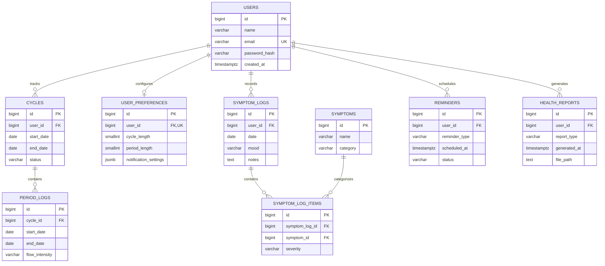

# Nura - Database Schema and Design

**Project:** Nura - A Personalized Menstrual Health Tracking and Awareness System  
**Document:** Database Schema and Design  
**Database:** PostgreSQL  
**ORM:** Prisma  
**Schema version:** 1.0  
**Status:** Initial design

## 1. Introduction

### 1.1 Purpose

This document describes the initial relational schema for Nura. It defines
entities, relationships, constraints, and indexing intended to support user
accounts, cycle tracking, period and symptom logs, reminders, and generated
health report metadata.

### 1.2 Design objectives

- Keep account, preference, cycle, and log data structured and consistent.
- Support multiple cycles and daily symptom logs per user.
- Represent reusable symptoms without duplicating their definitions.
- Enforce referential integrity and basic validation in PostgreSQL.
- Store report metadata and references, not report files themselves.

## 2. Entities

The initial design contains nine entities:

| Entity | Purpose |
| --- | --- |
| Users | Account details and password hashes. |
| UserPreferences | Cycle preferences and notification settings. |
| Cycles | Menstrual cycle records belonging to a user. |
| PeriodLogs | Period intervals and flow intensity within a cycle. |
| SymptomLogs | Daily mood, symptom-log date, and optional notes. |
| Symptoms | Reusable symptom catalogue. |
| SymptomLogItems | Junction records connecting logs to symptoms, including severity. |
| Reminders | Scheduled user reminders and their status. |
| HealthReports | Report metadata and external file references. |

## 3. Relationships

### 3.1 Cardinalities

| Parent | Child | Cardinality |
| --- | --- | --- |
| Users | Cycles | One-to-many |
| Users | UserPreferences | One-to-zero-or-one (unique `user_id`) |
| Cycles | PeriodLogs | One-to-many |
| Users | SymptomLogs | One-to-many |
| SymptomLogs | SymptomLogItems | One-to-many |
| Symptoms | SymptomLogItems | One-to-many |
| Users | Reminders | One-to-many |
| Users | HealthReports | One-to-many |

The relationship between SymptomLogs and Symptoms is many-to-many, resolved by
SymptomLogItems. The unique constraint on `(symptom_log_id, symptom_id)` limits
each symptom to one entry per log.

### 3.2 ER model



## 4. Data dictionary

All primary keys are generated `BIGINT` identity values. Timestamps use
`TIMESTAMPTZ`; date-only values use `DATE`.

### 4.1 Users

| Column | Type | Constraints | Description |
| --- | --- | --- | --- |
| id | BIGINT | PK | Unique account identifier. |
| name | VARCHAR(100) | NOT NULL | Display name. |
| email | VARCHAR(255) | UNIQUE, NOT NULL | Account email. |
| password_hash | VARCHAR(255) | NOT NULL | Password hash; never store the raw password. |
| created_at | TIMESTAMPTZ | NOT NULL, DEFAULT NOW() | Account creation time. |

### 4.2 UserPreferences

| Column | Type | Constraints | Description |
| --- | --- | --- | --- |
| id | BIGINT | PK | Unique preference identifier. |
| user_id | BIGINT | FK, UNIQUE, NOT NULL | References `Users.id`; at most one row per user. |
| cycle_length | SMALLINT | NOT NULL, CHECK 1-120 | User-provided or estimated cycle length in days. |
| period_length | SMALLINT | NOT NULL, CHECK 1-30 | User-provided or estimated period length in days. |
| notification_settings | JSONB | NOT NULL, DEFAULT `{}` | Notification preferences. |

### 4.3 Cycles

| Column | Type | Constraints | Description |
| --- | --- | --- | --- |
| id | BIGINT | PK | Unique cycle identifier. |
| user_id | BIGINT | FK, NOT NULL | References `Users.id`. |
| start_date | DATE | NOT NULL | Cycle start date. |
| end_date | DATE | NULL, CHECK >= `start_date` | End date, if completed. |
| status | VARCHAR(20) | NOT NULL, DEFAULT `active`, CHECK | `active` or `completed`. |

### 4.4 PeriodLogs

| Column | Type | Constraints | Description |
| --- | --- | --- | --- |
| id | BIGINT | PK | Unique period-log identifier. |
| cycle_id | BIGINT | FK, NOT NULL | References `Cycles.id`. |
| start_date | DATE | NOT NULL | Period interval start. |
| end_date | DATE | NULL, CHECK >= `start_date` | Period interval end. |
| flow_intensity | VARCHAR(20) | NOT NULL, CHECK | `spotting`, `light`, `medium`, or `heavy`. |

### 4.5 SymptomLogs

| Column | Type | Constraints | Description |
| --- | --- | --- | --- |
| id | BIGINT | PK | Unique symptom-log identifier. |
| user_id | BIGINT | FK, NOT NULL | References `Users.id`. |
| date | DATE | NOT NULL | Date of the entry. |
| mood | VARCHAR(50) | NULL | User-recorded mood. |
| notes | TEXT | NULL | Optional observations. |

### 4.6 Symptoms

| Column | Type | Constraints | Description |
| --- | --- | --- | --- |
| id | BIGINT | PK | Unique symptom identifier. |
| name | VARCHAR(100) | NOT NULL | Symptom name. |
| category | VARCHAR(50) | NOT NULL | Symptom category. |

The `(name, category)` pair is unique.

### 4.7 SymptomLogItems

| Column | Type | Constraints | Description |
| --- | --- | --- | --- |
| id | BIGINT | PK | Unique junction-row identifier. |
| symptom_log_id | BIGINT | FK, NOT NULL | References `SymptomLogs.id`. |
| symptom_id | BIGINT | FK, NOT NULL | References `Symptoms.id`. |
| severity | VARCHAR(20) | NOT NULL, CHECK | `mild`, `moderate`, or `severe`. |

The `(symptom_log_id, symptom_id)` pair is unique.

### 4.8 Reminders

| Column | Type | Constraints | Description |
| --- | --- | --- | --- |
| id | BIGINT | PK | Unique reminder identifier. |
| user_id | BIGINT | FK, NOT NULL | References `Users.id`. |
| reminder_type | VARCHAR(50) | NOT NULL | Reminder category. |
| scheduled_at | TIMESTAMPTZ | NOT NULL | Scheduled date and time. |
| status | VARCHAR(20) | NOT NULL, DEFAULT `pending`, CHECK | `pending`, `sent`, `completed`, or `cancelled`. |

### 4.9 HealthReports

| Column | Type | Constraints | Description |
| --- | --- | --- | --- |
| id | BIGINT | PK | Unique report identifier. |
| user_id | BIGINT | FK, NOT NULL | References `Users.id`. |
| report_type | VARCHAR(50) | NOT NULL | Report category. |
| generated_at | TIMESTAMPTZ | NOT NULL, DEFAULT NOW() | Generation time. |
| file_path | TEXT | NOT NULL | Reference to externally stored report content. |

## 5. PostgreSQL schema

The Prisma models are in `server/prisma/schema.prisma`. The initial migration
is in `server/prisma/migrations/20261114063826_init/migration.sql`. Prisma
models describe the columns, relations, unique constraints, and indexes.
PostgreSQL `CHECK` constraints are also included in the initial SQL migration
because Prisma schema syntax does not express these checks.

```sql
CREATE TABLE users (
    id BIGINT GENERATED ALWAYS AS IDENTITY PRIMARY KEY,
    name VARCHAR(100) NOT NULL,
    email VARCHAR(255) NOT NULL UNIQUE,
    password_hash VARCHAR(255) NOT NULL,
    created_at TIMESTAMPTZ NOT NULL DEFAULT NOW()
);

CREATE TABLE user_preferences (
    id BIGINT GENERATED ALWAYS AS IDENTITY PRIMARY KEY,
    user_id BIGINT NOT NULL UNIQUE REFERENCES users(id) ON DELETE CASCADE,
    cycle_length SMALLINT NOT NULL CHECK (cycle_length BETWEEN 1 AND 120),
    period_length SMALLINT NOT NULL CHECK (period_length BETWEEN 1 AND 30),
    notification_settings JSONB NOT NULL DEFAULT '{}'::jsonb
);

CREATE TABLE cycles (
    id BIGINT GENERATED ALWAYS AS IDENTITY PRIMARY KEY,
    user_id BIGINT NOT NULL REFERENCES users(id) ON DELETE CASCADE,
    start_date DATE NOT NULL,
    end_date DATE,
    status VARCHAR(20) NOT NULL DEFAULT 'active',
    CONSTRAINT chk_cycle_dates CHECK (end_date IS NULL OR end_date >= start_date),
    CONSTRAINT chk_cycle_status CHECK (status IN ('active', 'completed'))
);

CREATE TABLE period_logs (
    id BIGINT GENERATED ALWAYS AS IDENTITY PRIMARY KEY,
    cycle_id BIGINT NOT NULL REFERENCES cycles(id) ON DELETE CASCADE,
    start_date DATE NOT NULL,
    end_date DATE,
    flow_intensity VARCHAR(20) NOT NULL,
    CONSTRAINT chk_period_dates CHECK (end_date IS NULL OR end_date >= start_date),
    CONSTRAINT chk_flow_intensity
        CHECK (flow_intensity IN ('spotting', 'light', 'medium', 'heavy'))
);

CREATE TABLE symptom_logs (
    id BIGINT GENERATED ALWAYS AS IDENTITY PRIMARY KEY,
    user_id BIGINT NOT NULL REFERENCES users(id) ON DELETE CASCADE,
    date DATE NOT NULL,
    mood VARCHAR(50),
    notes TEXT
);

CREATE TABLE symptoms (
    id BIGINT GENERATED ALWAYS AS IDENTITY PRIMARY KEY,
    name VARCHAR(100) NOT NULL,
    category VARCHAR(50) NOT NULL,
    CONSTRAINT uq_symptom_name_category UNIQUE (name, category)
);

CREATE TABLE symptom_log_items (
    id BIGINT GENERATED ALWAYS AS IDENTITY PRIMARY KEY,
    symptom_log_id BIGINT NOT NULL REFERENCES symptom_logs(id) ON DELETE CASCADE,
    symptom_id BIGINT NOT NULL REFERENCES symptoms(id) ON DELETE RESTRICT,
    severity VARCHAR(20) NOT NULL,
    CONSTRAINT uq_log_symptom UNIQUE (symptom_log_id, symptom_id),
    CONSTRAINT chk_symptom_severity
        CHECK (severity IN ('mild', 'moderate', 'severe'))
);

CREATE TABLE reminders (
    id BIGINT GENERATED ALWAYS AS IDENTITY PRIMARY KEY,
    user_id BIGINT NOT NULL REFERENCES users(id) ON DELETE CASCADE,
    reminder_type VARCHAR(50) NOT NULL,
    scheduled_at TIMESTAMPTZ NOT NULL,
    status VARCHAR(20) NOT NULL DEFAULT 'pending',
    CONSTRAINT chk_reminder_status
        CHECK (status IN ('pending', 'sent', 'completed', 'cancelled'))
);

CREATE TABLE health_reports (
    id BIGINT GENERATED ALWAYS AS IDENTITY PRIMARY KEY,
    user_id BIGINT NOT NULL REFERENCES users(id) ON DELETE CASCADE,
    report_type VARCHAR(50) NOT NULL,
    generated_at TIMESTAMPTZ NOT NULL DEFAULT NOW(),
    file_path TEXT NOT NULL
);

CREATE INDEX idx_cycles_user_id ON cycles(user_id);
CREATE INDEX idx_period_logs_cycle_id ON period_logs(cycle_id);
CREATE INDEX idx_symptom_logs_user_date ON symptom_logs(user_id, date);
CREATE INDEX idx_symptom_items_symptom_id ON symptom_log_items(symptom_id);
CREATE INDEX idx_reminders_user_scheduled ON reminders(user_id, scheduled_at);
CREATE INDEX idx_health_reports_user_id ON health_reports(user_id);
```

## 6. Referential integrity

| Relationship | On delete | Reason |
| --- | --- | --- |
| Users -> UserPreferences | CASCADE | Preferences belong to one user. |
| Users -> Cycles | CASCADE | Cycle records belong to one user. |
| Cycles -> PeriodLogs | CASCADE | Period logs belong to one cycle. |
| Users -> SymptomLogs | CASCADE | Symptom logs belong to one user. |
| SymptomLogs -> SymptomLogItems | CASCADE | Junction rows have no meaning without their log. |
| Symptoms -> SymptomLogItems | RESTRICT | Preserve catalogue entries referenced by logs. |
| Users -> Reminders | CASCADE | Reminders belong to one user. |
| Users -> HealthReports | CASCADE | Report metadata belongs to one user. |

## 7. Normalization

- **First normal form:** Each field stores a single value; repeated symptoms
  are represented as separate related rows.
- **Second normal form:** Symptom severity belongs to a symptom occurrence and
  is stored on the junction row, not on the reusable symptom definition.
- **Third normal form:** Account data, preferences, cycle data, symptom
  catalogue entries, reminders, and report metadata are maintained in separate
  entities to avoid unrelated duplication.

## 8. Design decisions

### 8.1 UserPreferences

Preferences are separated from account credentials. A unique `user_id`
enforces at most one preference row per user; it does not guarantee that each
user already has one. Registration should create the preference row in the
same transaction if the application requires one for every account.

### 8.2 SymptomLogItems

The junction table implements the many-to-many relationship between logs and
the symptom catalogue and records severity for each logged occurrence.

### 8.3 Cycles and period logs

Cycles describe broader tracking intervals; period logs record bleeding
intervals within them. The application must validate consistency between these
intervals. Confirm that multiple period intervals per cycle are intended
before enforcing a stricter one-period-per-cycle rule.

### 8.4 JSONB notification settings

JSONB allows notification preferences to evolve without adding a column for
each setting. Validate its shape in the application.

### 8.5 Health report storage

Store report files in controlled file/object storage and keep only a reference
in the database. Do not expose server filesystem paths or unrestricted report
URLs to clients.

## 9. Indexing

Indexes support the expected lookups by user, date, and parent record:

- `cycles(user_id)`
- `period_logs(cycle_id)`
- `symptom_logs(user_id, date)`
- `symptom_log_items(symptom_id)`
- `reminders(user_id, scheduled_at)`
- `health_reports(user_id)`

Primary-key and unique constraints create indexes for their columns. In
particular, `symptom_log_items(symptom_log_id, symptom_id)` also supports
lookups beginning with `symptom_log_id`; the separate `symptom_id` index
supports lookups in the other direction.

## 10. ORM mapping

Prisma models map to the PostgreSQL tables using explicit table and column
names. Relations use the foreign keys and deletion rules described above.
Prisma migrations should be the applied schema history. Since the Prisma
schema does not represent the `CHECK` constraints listed above, preserve those
constraints in migration SQL and verify generated migrations before applying
them.

## 11. Assumptions and implementation considerations

1. Each user has at most one preferences row.
2. Cycle and period lengths are estimates or user-provided values, not medical
   guarantees.
3. Each period log belongs to exactly one cycle.
4. Symptom definitions are reusable catalogue entries.
5. Report files are stored outside PostgreSQL.
6. Application validation must cover interval consistency across rows.
7. Health information and authentication data require appropriate access
   controls; password values must be hashed before storage.

## 12. Future enhancements

Potential additions include more detailed flow tracking, cycle prediction,
additional health metrics, and report-generation workflows. Add entities or
attributes only when supported by a functional requirement.

## 13. Conclusion

This nine-entity design provides a normalized PostgreSQL foundation for Nura.
Its Prisma models, foreign keys, uniqueness rules, deletion behavior, indexes,
and database checks should evolve together through reviewed migrations.

Representative SQL operations are collected in
[`Database-Queries.sql`](./Database-Queries.sql).
