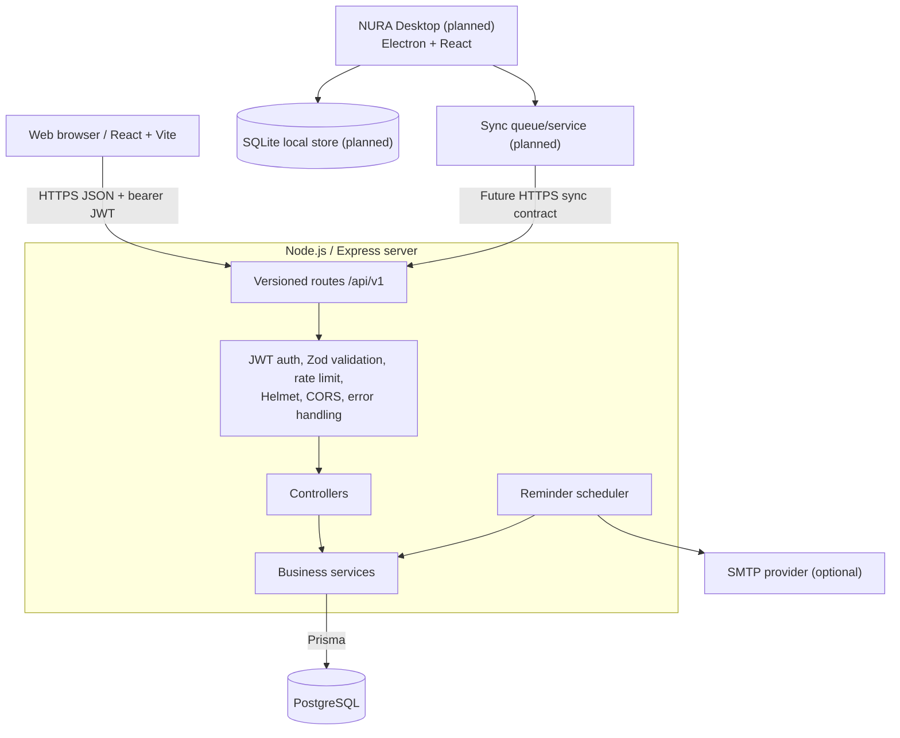

# NURA — System Architecture

**Status:** Existing online architecture plus proposed desktop extension. The desktop elements are not yet implemented.

## 1. Architecture diagram

## 2. Implemented online components

| Component | Technology/location | Responsibility |
| --- | --- | --- |
| Web UI | React 19, Vite, React Router | Landing, login, registration, protected dashboard |
| API client | `client/src/api/client.js` | Fetch wrapper, base URL, bearer token, normalized errors |
| HTTP server | Express 5, `server/src/app.js` | Middleware, health routes, API v1, not-found/error handling |
| Routes | `server/src/routes` | Auth, cycles, symptoms, users, reminders, insights |
| Validation | Zod validators | Validate external request payloads |
| Authentication | JWT utilities and middleware | Verify bearer token and attach user ID |
| Domain logic | `server/src/services` | Business operations and reminder delivery |
| Persistence | Prisma 7 + PostgreSQL adapter | Database access and migrations |
| Database | PostgreSQL | Account, preferences, cycle, log, reminder, report metadata |
| Background worker | `reminderScheduler.js` | Poll due reminders when email sender is configured |

## 3. Request lifecycle
1. Client sends request to versioned API.
2. Express applies security headers, CORS, JSON parsing, and rate limiting.
3. Protected routes verify bearer token.
4. Zod validates request payloads where configured.
5. Controller delegates work to service.
6. Service reads/writes through Prisma.
7. API returns JSON success or error response.

## 4. Proposed desktop architecture
- Electron main process owns privileged desktop operations.
- React renderer displays UI.
- Context-isolated preload bridge exposes a narrow allowlist of operations; do not expose unrestricted Node.js APIs.
- SQLite stores supported offline records and durable outbox.
- Sync service retries queued operations after connectivity returns.
- Future sync endpoints require client operation IDs/idempotency, ownership checks, validation, and conflict handling.
- Choose and test local encryption/secure credential storage before saving health data.

## 5. Trust boundaries and security
- Browser/renderer to API: HTTPS in production.
- Electron renderer to main process: context isolation and explicit IPC allowlist.
- API to PostgreSQL: private connectivity and least-privilege credentials.
- API to SMTP: authenticated TLS where supported.
- Never commit `.env`, JWT secrets, database passwords, SMTP credentials, or personal health data.
- CORS is not authentication; protected endpoints must authenticate and enforce record ownership.

## 6. Deployment topology
Production hosting provider and domains are not selected in the reviewed repository. Target topology: static frontend host/CDN, Node.js API host, and managed/private PostgreSQL. Use HTTPS and exact allowed frontend origins.

## 7. Known limitations
- Current CORS allowlist contains only local Vite origins.
- Vite proxy targets localhost:5001 and is development-only.
- No production hosting or CI/CD configuration was found.
- No desktop shell, SQLite store, offline queue, or sync API was found.
- README says health-report file generation is not implemented.
