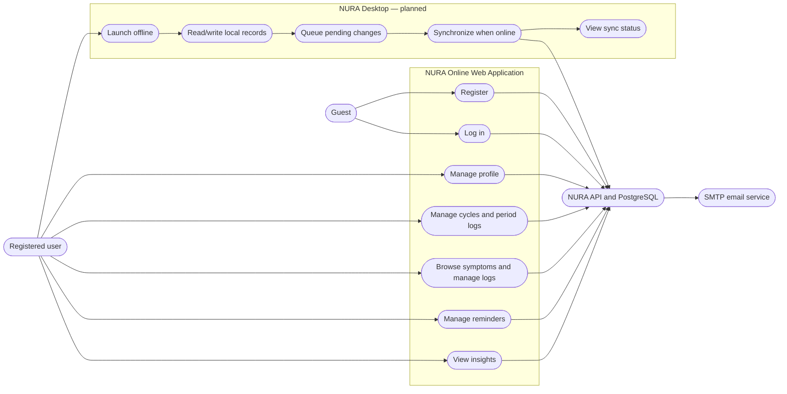

# NURA — Use-case Diagram and Descriptions

**Status:** Online use cases reflect implemented routes. Desktop use cases are planned.

## 1. Actors
- Guest: visitor who is not authenticated.
- Registered user: authenticated NURA user.
- NURA API/PostgreSQL: online service used by web app and future desktop sync.
- SMTP service: optional reminder email provider.

## 2. Use-case diagram

## 3. Use-case descriptions

### UC-01 Register
**Actor:** Guest. **Precondition:** email is not already registered.  
**Flow:** enter name, email, password; client submits; API validates and creates account; user and token are returned.  
**Alternative:** invalid input or duplicate email returns an error.  
**Postcondition:** account exists and authenticated session can be established.

### UC-02 Log in
**Actor:** Guest/registered user. **Precondition:** account exists.  
**Flow:** submit email and password; API verifies credentials and returns user and JWT.  
**Alternative:** invalid credentials return authentication failure.  
**Postcondition:** authenticated session established.

### UC-03 Manage cycles and period logs
**Actor:** Registered user. **Precondition:** authenticated.  
**Flow:** list/create/retrieve/update/delete own cycles and manage period logs nested under a cycle.  
**Alternative:** invalid dates, inaccessible record, or service failure returns an error.  
**Postcondition:** data persisted to PostgreSQL.

### UC-04 Record symptoms
**Actor:** Registered user. **Precondition:** authenticated.  
**Flow:** browse symptom catalogue; create dated log with optional mood/notes and symptom severity; view/update/delete history.  
**Alternative:** invalid fields or duplicate symptom entries in one log are rejected.  
**Postcondition:** symptom log persisted.

### UC-05 Manage reminders
**Actor:** Registered user. **Precondition:** authenticated.  
**Flow:** create reminder with type and scheduled datetime; list/retrieve/update/delete it.  
**Alternative:** invalid datetime or unauthorized request is rejected.  
**Postcondition:** reminder is stored; email delivery is conditional on SMTP setup and successful delivery.

### UC-06 View insights
**Actor:** Registered user. **Precondition:** authenticated.  
**Flow:** request insights; API returns available cycle-related information.  
**Postcondition:** informational summary shown; not a medical diagnosis.

### UC-07 Use desktop offline — planned
**Actor:** Registered user. **Precondition:** desktop app installed and local store initialized.  
**Flow:** launch without network; load local records; add/edit supported records; persist locally; show pending sync state.  
**Postcondition:** saved local records remain after restart.

### UC-08 Synchronize offline changes — planned
**Actor:** Registered user/network service. **Precondition:** queued changes exist and network returns.  
**Flow:** authenticate; send queued operations; server validates ownership/idempotency; client marks accepted changes synced and refreshes remote data.  
**Alternative:** failed requests remain queued; conflicts are surfaced according to agreed policy.  
**Postcondition:** accepted changes are reflected online without duplicate creation or silent data loss.

See `API-SPECIFICATION.md` for implemented API routes. UC-07 and UC-08 must not be marked complete until demonstrated.
